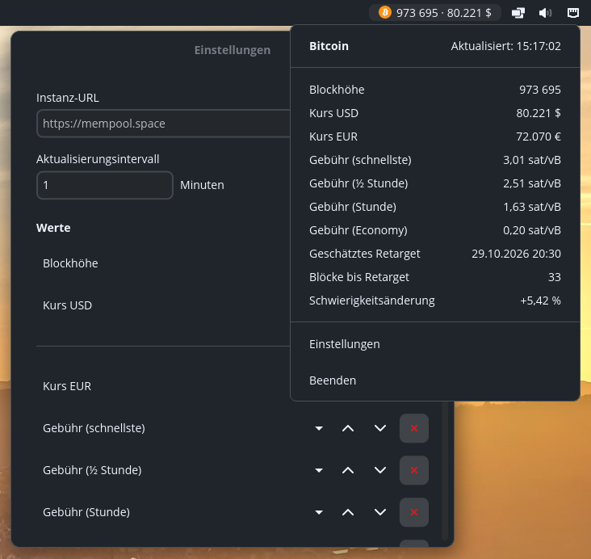

# cosmic-applet-bitcoin

A native **COSMIC panel applet** that displays configurable
[mempool.space](https://mempool.space/) values in the panel: BTC prices in
any supported currency, fee estimates and the current block height.



## Install (user-local, from source)

Requires Rust plus system packages (`libwayland-dev`, `libxkbcommon-dev`, …).

```bash
cargo build --release
./install.sh
```

Then add the *Bitcoin* applet to a panel wing in
**Settings → Panel → Applets**.

## Configuration

All settings are configured in the applet's own settings window
(popup → *Settings*): instance URL (default `https://mempool.space`),
refresh interval (minutes, default 1) and the value list via dropdown
(price per currency, fee tiers, block height).

The **boundary line** in the value list marks what appears in the panel
next to the logo: values above the line are shown in the panel (initially
"Price USD" + "Block height"), the complete list is always shown in the
popup. Move values across the line with the arrow buttons; the line itself
moves with its own arrows. The "✗" buttons delete a row.

Everything is persisted in

```
~/.config/cosmic-applet-bitcoin/config.toml   (permissions 0600)
```

Values are polled via REST at the configured interval — each cycle only
requests the endpoints the selected values need. Changes saved in the
settings window are picked up within about a second (config-file watcher)
— no restart needed.

## Used endpoints

- `GET /api/v1/prices` — price per currency
- `GET /api/v1/fees/precise` — fee estimates (sat/vB)
- `GET /api/blocks/tip/height` — current block height

## Development

```bash
cargo test
cargo clippy --all-targets -- -D warnings
```

## Localization

All user-facing strings ship in English and German
(`i18n/en`, `i18n/de`, Fluent via `i18n-embed`).
